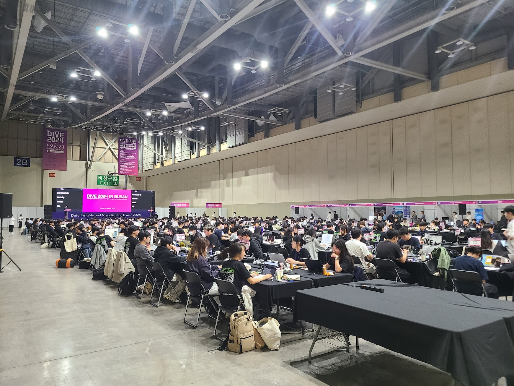
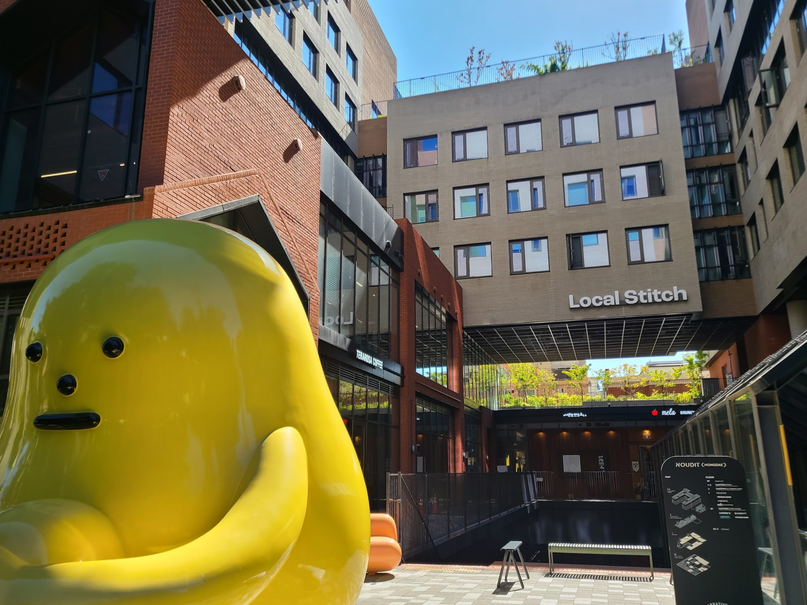
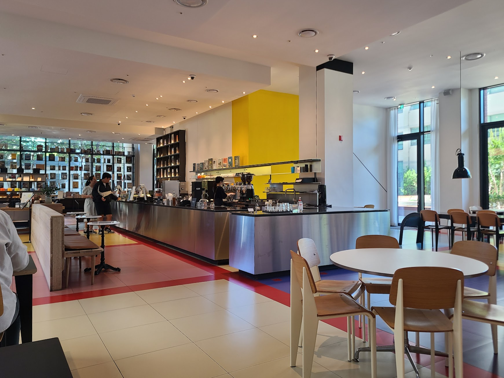
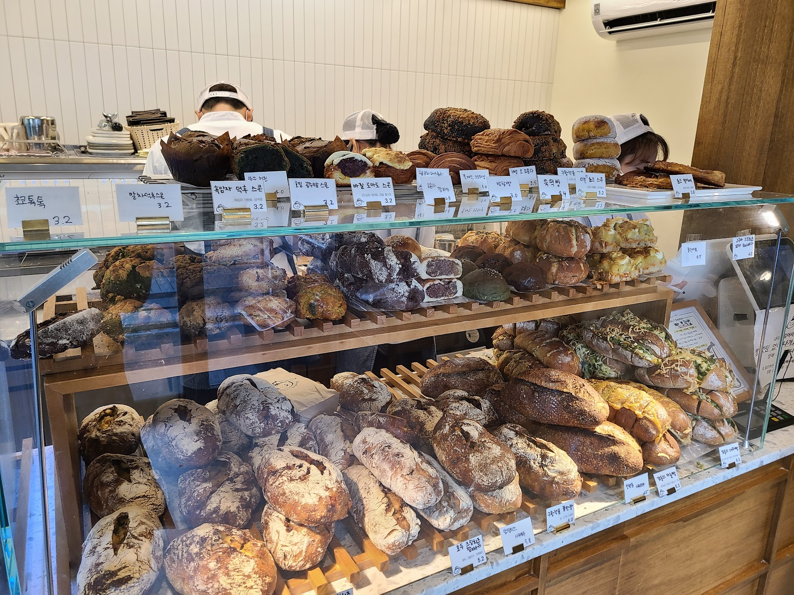

## 문제 1

Q: 다음 이미지에 대한 설명 중 옳지 않은 것은 무엇인가요?

- (1) 넓은 행사장 안에 많은 사람들이 테이블에 앉아 있습니다.
- (2) 행사장 앞쪽에 “DIVE 2024 IN BUSAN”이라는 문구가 보입니다.
- (3) 행사에 참여한 사람들 중 일부는 노트북을 사용하고 있습니다.
- (4) 행사장에는 사람들이 전혀 없고 빈 테이블만 놓여 있습니다.

정답: (4) 행사장에는 많은 사람들이 앉아 행사를 진행하고 있으므로, 빈 테이블만 놓여 있다는 설명은 옳지 않습니다.

---------------------

## 문제 2

Q: 다음 이미지에 대한 설명 중 옳지 않은 것은 무엇인가요?

- (1) 건물 사이의 야외 공간에 커다란 노란색 조형물이 있습니다.
- (2) 사진 속 건물 외벽에는 “Local Stitch”라는 글자가 보입니다.
- (3) 주변에는 여러 층의 현대적인 건물들이 자리하고 있습니다.
- (4) 조형물은 파란색이며 모자를 쓰고 있습니다.

정답: (4) 조형물은 파란색이 아니라 노란색이며, 모자를 쓰고 있지 않습니다.

---------------------

## 문제 3

Q: 다음 이미지에 대한 설명 중 옳지 않은 것은 무엇인가요?

- (1) 실내에 음료를 주문할 수 있는 카운터가 있습니다.
- (2) 카페 안쪽 벽면에는 책이나 소품이 진열되어 있습니다.
- (3) 매장 곳곳에 의자와 테이블이 마련되어 있습니다.
- (4) 매장 중앙에 커다란 수영장이 있습니다.

정답: (4) 매장 중앙에는 수영장이 아니라 음료를 준비하는 카운터가 있습니다.

---------------------

## 문제 4

Q: 다음 이미지에 대한 설명 중 옳지 않은 것은 무엇인가요?

- (1) 빵집 진열대에 다양한 종류의 빵이 진열되어 있습니다.
- (2) 진열된 빵들 앞에 가격표가 놓여 있습니다.
- (3) 진열대 뒤에서 흰색 모자를 쓴 직원들이 빵을 정리하고 있습니다.
- (4) 진열대에는 빵 대신 여러 종류의 음료수만 놓여 있습니다.

정답: (4) 진열대에는 음료수만 있는 것이 아니라 다양한 종류의 빵이 진열되어 있습니다.

---------------------

## 문제 5

Q: 다음 이미지에 대한 설명 중 옳지 않은 것은 무엇인가요?

- (1) 넓은 실내에 여러 개의 테이블과 의자가 놓여 있습니다.
- (2) 한쪽 벽면에 큰 유리창이 있어 바깥 풍경이 보입니다.
- (3) 바닥은 나무 재질로 되어 있습니다.
- (4) 천장은 흰색으로 밝게 칠해져 있습니다.

정답: (4) 천장은 흰색이 아니라 어두운 색의 줄무늬 구조로 되어 있습니다.

---------------------

