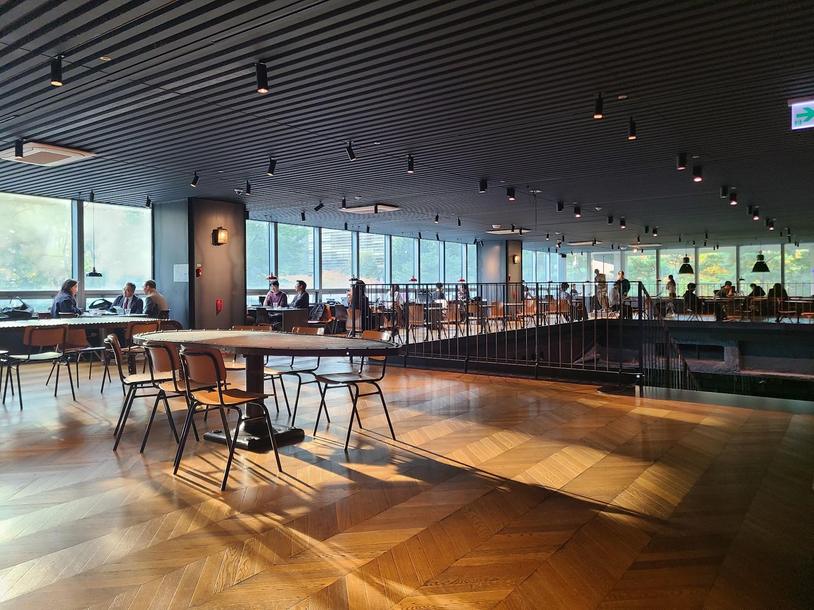

## 문제 1

Q: 다음 이미지에 대한 설명 중 옳지 않은 것은 무엇인가요?
- (1) 쇼케이스 안에는 다양한 빵이 진열되어 있습니다.
- (2) '쑥떡빵'이라는 빵의 가격은 3,000원입니다.
- (3) 직원들이 흰색 모자를 쓰고 있습니다.
- (4) 왼쪽 위에 '초코톡톡'이라는 빵이 있습니다.

2
정답: (2) '쑥떡빵'의 가격은 3,200원으로 3,000원이 아닙니다.

---------------------

## 문제 2

Q: 다음 이미지에 대한 설명 중 옳지 않은 것은 무엇인가요?
- (1) DIVE 2024 IN BUSAN이라는 행사에서 많은 사람들이 노트북을 사용하며 참여하고 있습니다.
- (2) 행사 장소는 2B 전시장으로 보입니다.
- (3) 참가자들이 주로 서서 토론하는 모습이 담겨 있습니다.
- (4) 뒤쪽에 Refresh Zone이라는 공간도 마련되어 있습니다.
3
정답: (3) 참가자들이 주로 앉아서 노트북을 사용하며 집중하는 모습이지, 서서 토론하는 모습은 아닙니다.

---------------------

## 문제 3

Q: 다음 이미지에 대한 설명 중 옳지 않은 것은 무엇인가요?
- (1) 카페 내부가 밝고 현대적인 인테리어로 꾸며져 있습니다.
- (2) 사진 중앙 뒤쪽에 바리스타가 커피를 만들고 있습니다.
- (3) 카페 바 옆에 빨간색 의자가 여러 개 놓여 있습니다.
- (4) 창문을 통해 자연광이 많이 들어오고 있습니다.
3
정답: (3) 카페 바 옆에 빨간색 의자가 아닌 나무색 의자가 놓여 있습니다.

---------------------

## 문제 4

Q: 다음 이미지에 대한 설명 중 옳지 않은 것은 무엇인가요?  
- (1) 큰 창문을 통해 자연광이 가득 들어오고 있습니다.  
- (2) 테이블 위에 음료수나 음식이 놓여 있습니다.  
- (3) 사람들이 여러 그룹으로 나누어 앉아 대화를 나누고 있습니다.  
- (4) 바닥은 나무 바닥으로 되어 있습니다.  
2  
정답: (2) 테이블 위에 음료수나 음식이 놓여 있지 않습니다.

---------------------

