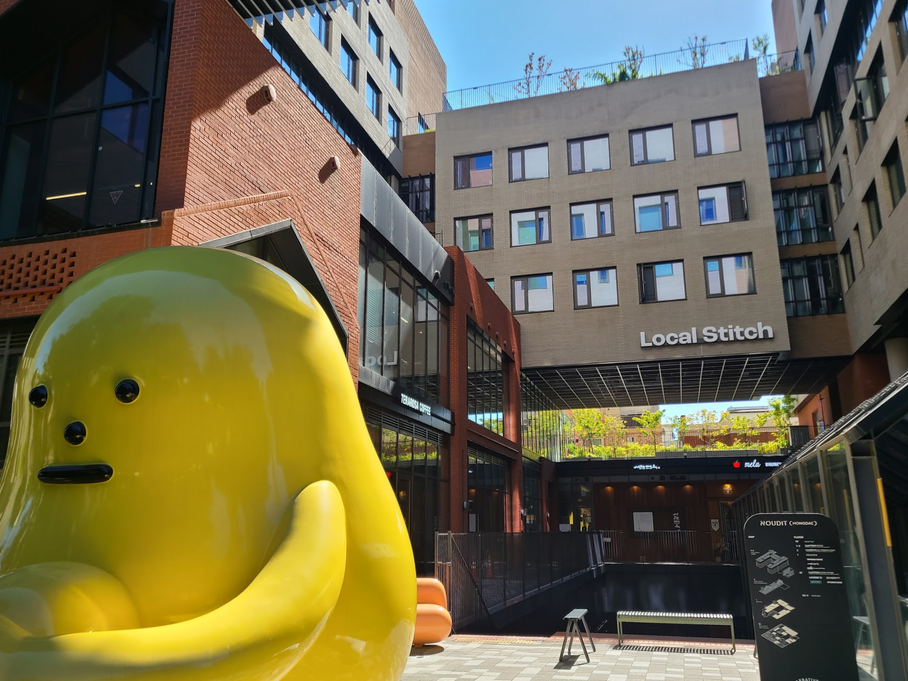
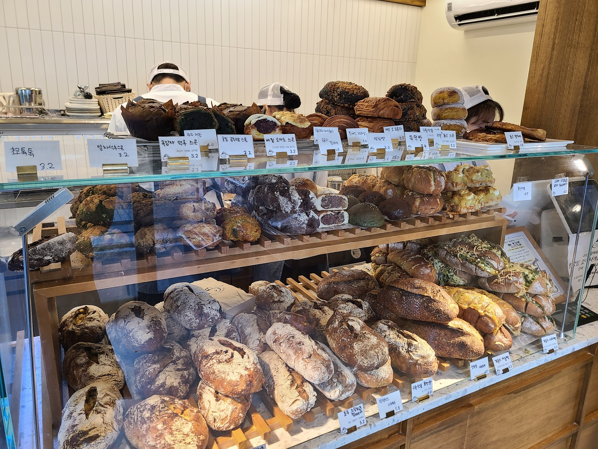
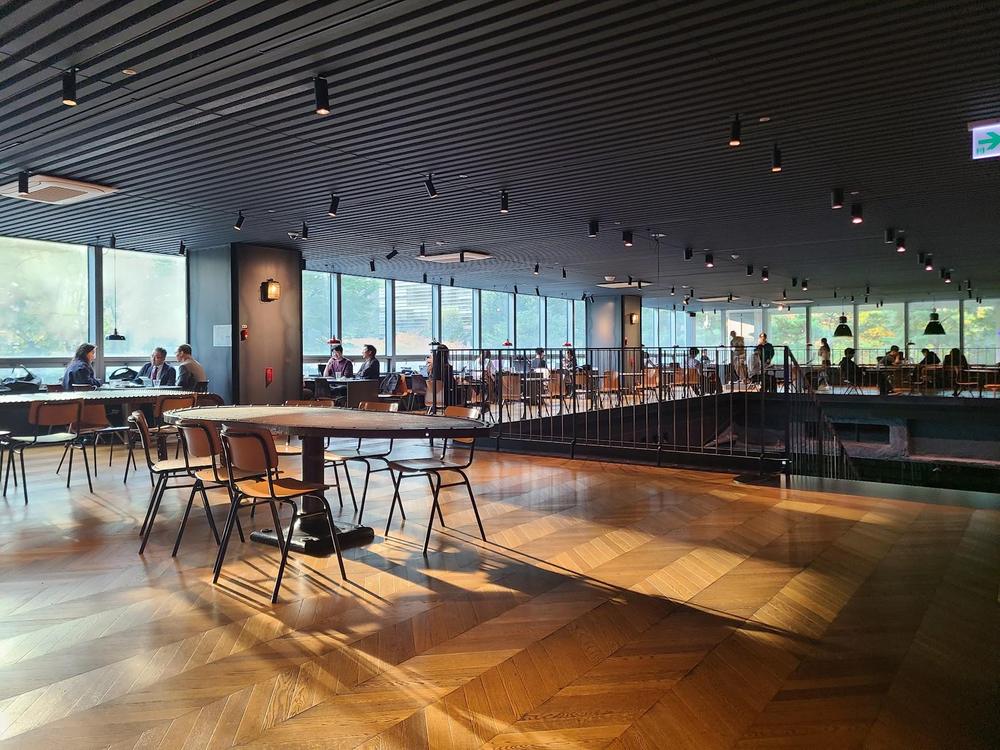

## 문제 1

Q: 다음 이미지에 대한 설명 중 옳지 않은 것은 무엇인가요?  
- (1) 대규모 행사가 열리고 있는 실내 공간이 보입니다.  
- (2) 많은 사람들이 테이블에 앉아 노트북을 사용하고 있습니다.  
- (3) 행사장 앞쪽에 대형 스크린과 안내 부스가 설치되어 있습니다.  
- (4) 대부분의 사람들이 야외에서 줄을 서서 기다리고 있습니다.  

Listening: Which of the following descriptions of the image is incorrect?  
- (1) A large event is taking place in an indoor venue.  
- (2) Many people are sitting at tables and using laptops.  
- (3) Large screens and information booths have been set up at the front of the venue.  
- (4) Most people are waiting in line outdoors.  

정답: **(4) 대부분의 사람들은 야외가 아니라 실내 행사장 안에서 테이블에 앉아 있습니다.**

---------------------

## 문제 2

Q: 다음 이미지에 대한 설명 중 옳지 않은 것은 무엇인가요?  
- (1) 건물들 사이에 야외 상업 공간이 조성되어 있습니다.  
- (2) 화면 왼쪽 앞쪽에 커다란 노란색 조형물이 있습니다.  
- (3) 건물 외벽에 “Local Stitch”라는 문구가 보입니다.  
- (4) 화면 중앙에 넓은 잔디밭이 펼쳐져 있습니다.  

Listening: Which of the following descriptions of the image is incorrect?  
- (1) An outdoor commercial space has been created between the buildings.  
- (2) There is a large yellow sculpture in the foreground on the left.  
- (3) The words “Local Stitch” can be seen on the exterior of a building.  
- (4) A large grassy lawn stretches across the center of the image.  

정답: **(4) 화면 중앙에는 넓은 잔디밭이 아니라 건물과 보행 공간이 있습니다.**

---------------------

## 문제 3

Q: 다음 이미지에 대한 설명 중 옳지 않은 것은 무엇인가요?  
- (1) 카페 안에 음료를 주문할 수 있는 카운터가 있습니다.  
- (2) 카페 벽면의 일부가 밝은 노란색으로 칠해져 있습니다.  
- (3) 실내에 여러 개의 테이블과 의자가 놓여 있습니다.  
- (4) 손님들이 야외 테라스에서 음료를 마시고 있습니다.  

Listening: Which of the following descriptions of the image is incorrect?  
- (1) There is a counter where customers can order drinks.  
- (2) Part of the café wall is painted bright yellow.  
- (3) There are several tables and chairs inside the café.  
- (4) Customers are drinking beverages on an outdoor terrace.  

정답: **(4) 손님들이 야외 테라스에서 음료를 마시고 있는 모습은 보이지 않고, 모두 실내에 있습니다.**

---------------------

## 문제 4

Q: 다음 이미지에 대한 설명 중 옳지 않은 것은 무엇인가요?  
- (1) 유리 진열대에 다양한 종류의 빵이 진열되어 있습니다.  
- (2) 진열대 뒤에 있는 직원들은 흰색 모자를 쓰고 있습니다.  
- (3) 빵마다 가격이 적힌 안내판이 놓여 있습니다.  
- (4) 진열대에는 신선한 과일과 채소가 주로 진열되어 있습니다.  

Listening: Which of the following descriptions of the image is incorrect?  
- (1) Various types of bread are displayed in a glass case.  
- (2) The employees behind the display case are wearing white caps.  
- (3) Signs showing the prices are placed next to the bread.  
- (4) Fresh fruits and vegetables are mainly displayed in the case.  

정답: **(4) 진열대에는 과일과 채소가 아니라 다양한 종류의 빵이 진열되어 있습니다.**

---------------------

## 문제 5

Q: 다음 이미지에 대한 설명 중 옳지 않은 것은 무엇인가요?  
- (1) 넓은 실내 식당의 모습이 보입니다.  
- (2) 여러 테이블에 사람들이 앉아 있습니다.  
- (3) 한쪽 벽을 따라 큰 창문이 나 있습니다.  
- (4) 모든 테이블이 비어 있습니다.  

Listening: Which of the following descriptions of the image is incorrect?  
- (1) It shows the interior of a spacious restaurant.  
- (2) People are seated at several tables.  
- (3) There are large windows along one wall.  
- (4) All of the tables are unoccupied.  

정답: **(4) 모든 테이블이 비어 있는 것이 아니라, 일부 테이블에는 사람들이 앉아 있습니다.**

---------------------

