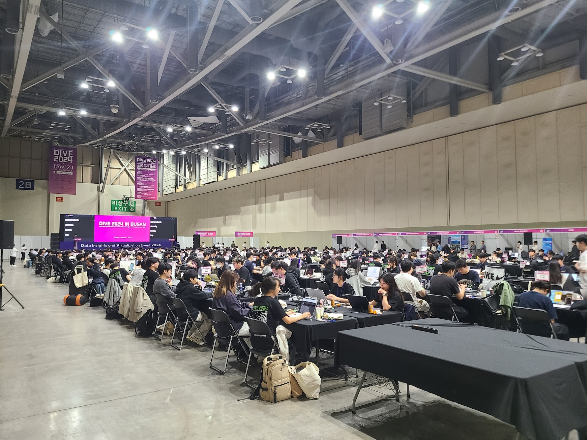
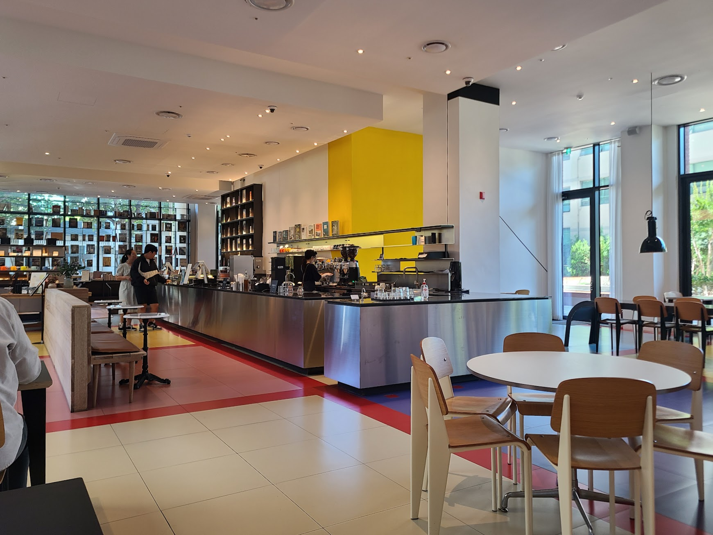

## 문제 1

Q: 다음 이미지에 대한 설명 중 옳지 않은 것은 무엇인가요?
- (1) 진열대 위에 바질 로마노 스콘이 있습니다.
- (2) 점원 셋 중 한 명은 하얀색 모자를 쓰고 있습니다.
- (3) 단팥빵은 3,800원입니다.
- (4) 고구마 크림치즈 파이 치즈케이크는 4,000원입니다.

Listening: Which of the following descriptions of the image is incorrect?
- (1) There is a basil romano scone on the top display.
- (2) One of the three clerks is wearing a white hat.
- (3) The red bean bread is priced at 3,800 won.
- (4) The sweet potato cream cheese pie cheesecake costs 4,000 won.

정답: (3) 단팥빵은 3,800원이 아니라 3,500원입니다.

---------------------

## 문제 2

Q: 이 이미지에 대한 설명 중 옳지 않은 것은 무엇인가요?
- (1) 많은 사람들이 노트북을 이용해 작업하고 있습니다.
- (2) 행사 장소는 도서관처럼 조용한 공간입니다.
- (3) 중간에 리프레시 존이 마련되어 있습니다.
- (4) 행사 명칭은 'DIVE 2024 IN BUSAN'입니다.

Listening: Which of the following descriptions of the image is incorrect?
- (1) Many people are working using laptops.
- (2) The event venue is a quiet space like a library.
- (3) A refresh zone is set up in the middle.
- (4) The event name is 'DIVE 2024 IN BUSAN.'

정답: (2) 행사 장소는 도서관이 아니라 넓은 전시장입니다.

---------------------

## 문제 3

Q: 다음 이미지에 대한 설명 중 옳지 않은 것은 무엇인가요?  
- (1) 카페 내부에 사람들이 음료를 주문하고 있습니다.  
- (2) 바닥에는 흰색과 빨간색 타일이 깔려 있습니다.  
- (3) 카운터 옆에는 탁자가 있고, 사람들이 앉아 있습니다.  
- (4) 노란색 벽면 아래에는 커피 머신과 컵들이 놓여 있습니다.  

Listening: Which of the following descriptions of the image is incorrect?  
- (1) People are ordering drinks inside the cafe.  
- (2) The floor is tiled in white and red colors.  
- (3) There are tables beside the counter with people sitting.  
- (4) Under the yellow wall, there are coffee machines and cups.  

정답: (3) 카운터 옆 탁자에 아무도 앉아 있지 않습니다.  
Answer: (3) There are no people sitting at the tables beside the counter.

---------------------

## 문제 4

Q: 다음 이미지에 관한 설명 중 옳지 않은 것은 무엇인가요?
- (1) 테이블 위에는 음료수가 놓여 있습니다.
- (2) 많은 사람들이 좌석에 앉아 대화를 나누고 있습니다.
- (3) 바닥은 나무 마루로 되어 있습니다.
- (4) 이 공간은 큰 창문을 통해 자연광이 잘 들어옵니다.

Listening: Which of the following descriptions of the image is incorrect?
- (1) There are drinks placed on the tables.
- (2) Many people are sitting and talking at the seats.
- (3) The floor is made of wooden parquet.
- (4) Natural light comes in well through the large windows.

정답: (1) 테이블 위에는 음료수가 놓여 있지 않았습니다.

---------------------

## 문제 5

Q: 다음 이미지에 관한 설명 중 옳지 않은 것은 무엇인가요?  
- (1) 노란색 커다란 조형물이 앞쪽에 있습니다.  
- (2) 건물 중 하나에 'Local Stitch'라는 간판이 붙어 있습니다.  
- (3) 사진 속 장소는 주로 주택가를 보여주고 있습니다.  
- (4) 'TERMOSIA COFFEE'라는 카페가 있습니다.

Listening: Which of the following descriptions of the image is incorrect?  
- (1) There is a large yellow sculpture in the foreground.  
- (2) One of the buildings has a sign that says 'Local Stitch.'  
- (3) The place shown in the photo is mainly a residential area.  
- (4) There is a café called 'TERMOSIA COFFEE.'  

정답: (3) 이 사진은 주택가가 아닌 상업 공간을 보여주고 있습니다.

---------------------

